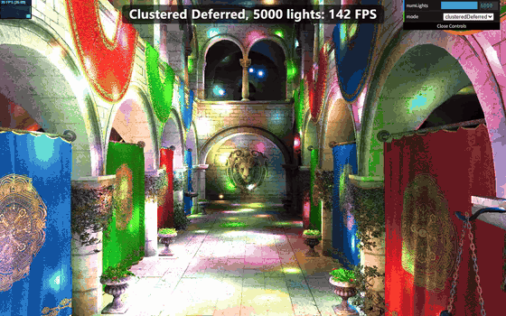
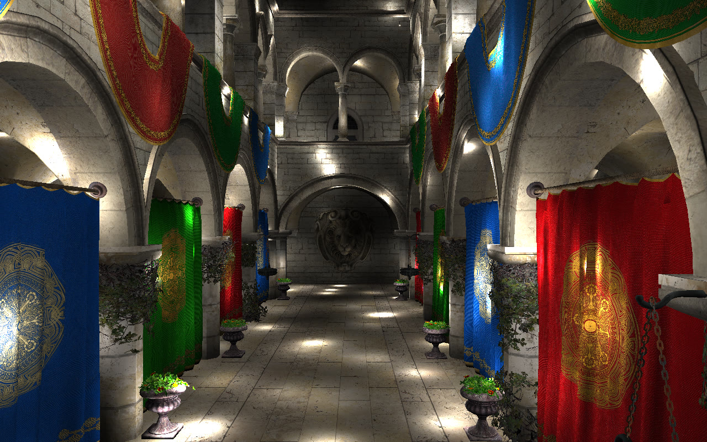
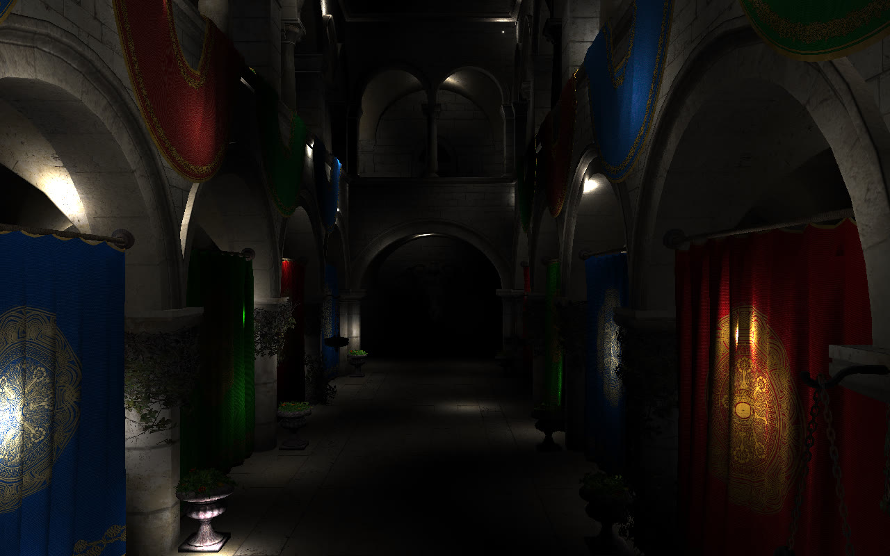
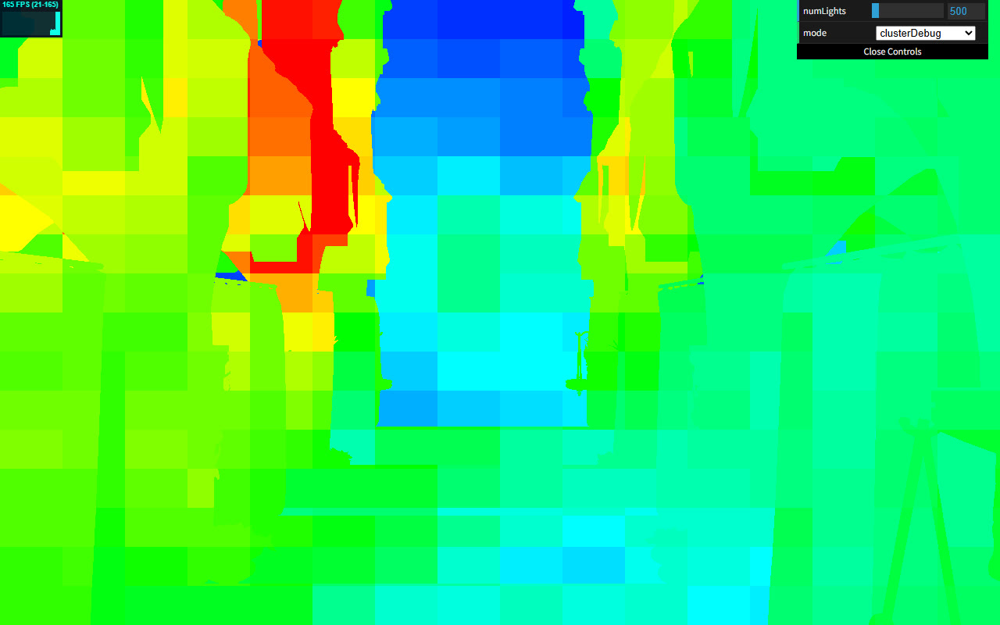
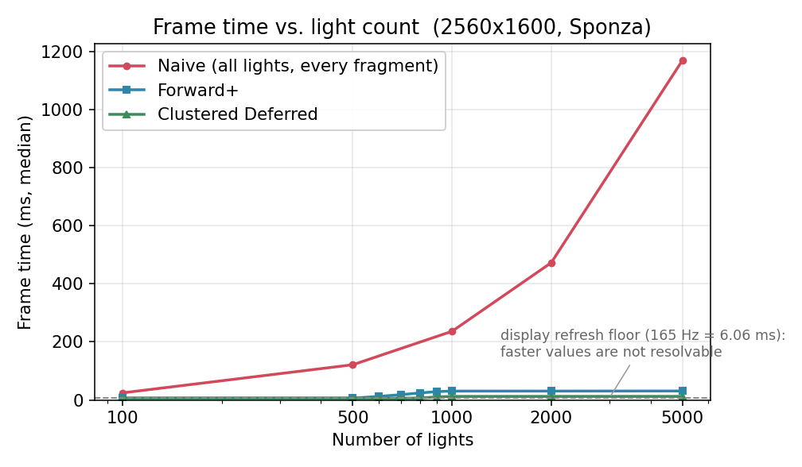
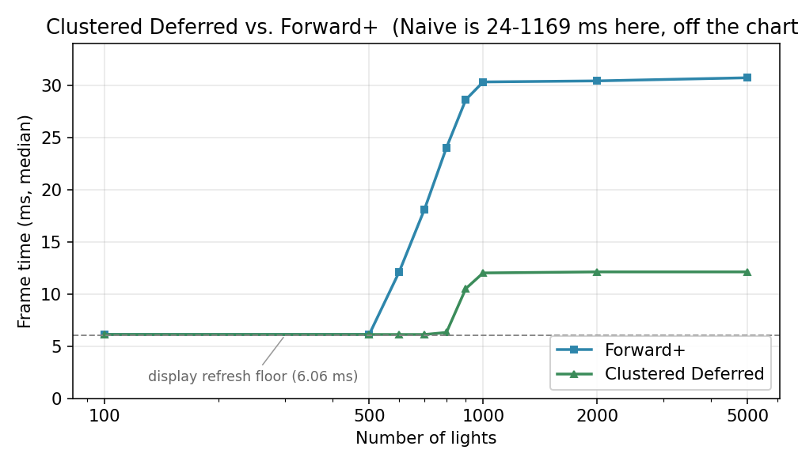

# WebGPU Forward+ and Clustered Deferred Shading

**University of Pennsylvania, CIS 565: GPU Programming and Architecture, Project 4**

* Jing Huang
* Tested on: **Google Chrome 154** on Windows 11, Intel i7-12700H @ 2.30GHz, 32GB,
  NVIDIA GeForce RTX 3060 Laptop GPU 6GB

### Live Demo

### Demo Video

A 45 second walkthrough of every mode is in [img/demo.mp4](img/demo.mp4): naive, Forward+,
Clustered Deferred and the cluster debug view, ending with Forward+ and Clustered Deferred running
the full 5000 lights.

## Overview

The scene is the Sponza atrium with up to 5000 moving point lights. Three renderers are implemented
on top of the provided framework, and the GUI switches between them:

| Mode | What it does |
|---|---|
| **Naive** | Every fragment loops over every light in the scene. |
| **Forward+** | Lights are binned into a 3D cluster grid; each fragment only walks the lights of its own cluster. |
| **Clustered Deferred** | Same clustering, but split into a G-buffer pass and a fullscreen shading pass so every pixel is lit exactly once. |
| **Cluster debug** | Reuses the naive geometry pass with a different fragment shader to visualise the per-cluster light count. |

### Light clustering

The view frustum is cut into **16 x 16 screen tiles x 24 depth slices** (6144 clusters). Depth
slices grow exponentially, `d_k = near * (far/near)^(k/K)`, between `clusterNear` (the camera's near
plane, so no gap is left in front of it) and `clusterFar = 100` world units, with the outermost
slice reaching all the way to the far plane.

A uniform split of the NDC depth range looks like the simpler choice, but it is not usable here:
the camera's near/far ratio is 0.1 : 1000 while NDC depth is a function of 1/d, so 23 of the 24
slices would cover only the first 2.4 metres in front of the camera and the last slice would swallow
everything from 2.4 to 1000 units, degenerating into the brute force loop. Slicing the view
distance exponentially instead makes the distribution independent of the near/far ratio.

The clustering compute shader gives each cluster one thread. It unprojects the eight corners of the
cluster's frustum cell into world space, takes their AABB (the cell is the convex hull of those
corners, so the AABB is a conservative bound), and then records the index of every light whose range
sphere overlaps it. Lights are point lights with a hard range cutoff, so a light can only be seen by
clusters its radius touches. Because the projection matrix follows the WebGPU depth convention
(near to 0, far to 1), a fragment can recover its own view distance from the depth buffer value with
`viewDistanceFromDepth`, which is how the shading passes find their cluster without needing the view
matrix.

Clusters are stored as two flat arrays - `clusterLightCounts` and `clusterLightIndices` - rather
than an array of structs, which keeps the host-side stride unambiguous.

## Screenshots

| Forward+, 2000 lights | Clustered Deferred, 2000 lights |
|---|---|
|  |  |

| Naive, 500 lights | Cluster debug view |
|---|---|
|  |  |

The cluster debug view tints every fragment by the number of lights in its cluster, so the 16 x 16
tile grid and the depth banding are both visible at a glance. It is also how the correctness of the
cluster lookup was checked (see below).

## Correctness

Both clustered renderers were checked against the naive renderer by freezing the lights (they are
driven by the frame time, so an unfrozen scene changes on every frame) and comparing screenshots
pixel by pixel at 1280x800:

| Comparison | 500 lights | 2000 lights | 5000 lights |
|---|---|---|---|
| naive vs naive (control) | 0 pixels | 0 pixels | 0 pixels |
| naive vs **Forward+** | **0 pixels** | **0 pixels** | 738 px (0.07%), max 13 |
| naive vs **Clustered Deferred** | - | max 16, 99.7% of differing pixels differ by 1 level | - |

A light that can reach a fragment lies inside that fragment's cluster AABB, so the cluster list is a
superset of the lights the naive shader accumulates and the two renderers should agree exactly.
Forward+ does, bit for bit, up to the `maxLightsPerCluster` cap. Clustered Deferred differs only by
G-buffer quantisation (albedo is stored at 8 bits, normals at half precision): the difference image
has no structure at all, 367954 of the 368904 differing pixels are off by a single level, and only
two pixels out of 1.02 million are off by more than 8.

The clustering itself was verified separately against an independent CPU implementation of the same
maths: for a known light configuration the 6144 clusters matched exactly, in both counts and index
order, and lights placed behind the camera or outside the frustum were correctly assigned to no
cluster at all.

## Performance analysis

### Methodology

Measurements come from a headless Chrome harness that drives the real page: 2560x1600 render target
(`deviceScaleFactor 2`), the light animation pinned to a fixed moment so that every mode shades the
identical scene, 10 warmup frames and then a 4 second measurement window, reporting the **median
frame interval in milliseconds** between `requestAnimationFrame` callbacks.

One caveat matters for reading the numbers: the browser presents at 165 Hz, so every frame time is a
multiple of 6.06 ms. A reported 6.1 ms therefore means *"6.06 ms or less - not resolvable"*, and each
other value should be read as "the true frame time lies between one quantum below and the reported
value". The render target was raised to 2560x1600 specifically to push the interesting
configurations clear of that floor. V-Sync pacing is kept on deliberately: with
`--disable-frame-rate-limit` the CPU outruns the GPU and the frame interval stops reflecting GPU
work altogether (medians swung between 0.9 ms and 356 ms for the same configuration).

### Frame time vs. light count

| Frame time (ms, median) | 100 | 500 | 600 | 700 | 800 | 900 | 1000 | 2000 | 5000 |
|---|---|---|---|---|---|---|---|---|---|
| Naive | 24.2 | 121.1 | | | | | 236.3 | 472.6 | 1169.5 |
| Forward+ | 6.1 | 6.1 | 12.1 | 18.1 | 24.0 | 28.6 | 30.3 | 30.4 | 30.7 |
| Clustered Deferred | 6.1 | 6.1 | 6.1 | 6.1 | 6.3 | 10.5 | 12.0 | 12.1 | 12.1 |

**Naive is linear in the number of lights.** 24.2 ms at 100 lights, 1169.5 ms at 5000 - very close
to 0.23 ms per light per frame all the way up. Every one of the 4.1 million fragments of the
2560x1600 image walks the entire light array, so the cost is `fragments x lights` with nothing to
amortise.

**Forward+ and Clustered Deferred stop caring about the light count.** Both are flat from 1000
lights to 5000: Forward+ moves from 30.3 to 30.7 ms while the light count quintuples, and Clustered
Deferred stays at 12.1 ms. The reason is visible in the cluster occupancy:

| Lights | Non-empty clusters | Clusters at the 512 cap | Max lights in a cluster | Total light assignments |
|---|---|---|---|---|
| 100 | 4459 | 0 | 15 | 20600 |
| 500 | 4582 | 0 | 57 | 92593 |
| 1000 | 4582 | 185 | 512 | 181493 |
| 2000 | 4582 | 186 | 512 | 181494 |
| 5000 | 4582 | 186 | 512 | 181494 |

186 of the 6144 clusters - the 3% covering the near field, where the light cloud is densest - reach
`maxLightsPerCluster = 512` once there are about 1000 lights, and from there the total number of
light assignments saturates: 181493 at 1000 lights, 181494 at 5000. Shading work is proportional to
those assignments, not to the number of lights in the scene, so it stops growing. The clustering
pass itself is `clusters x lights` and does keep growing, but at 5000 lights it is still a fraction
of a millisecond: the whole sweep from 1000 to 5000 lights adds 0.4 ms. Decoupling the light loop
from the scene's light count is the entire point of the technique.

**Clustered Deferred is about 2.5x faster than Forward+** once the clusters saturate (12.0 ms vs
30.3 ms at 1000 lights, 12.1 vs 30.7 at 5000). The difference is overdraw. Forward+ still runs its
fragment shader for every fragment of every triangle covering the screen - with Sponza's arches,
curtains and layered walls a given pixel is shaded several times over - while Clustered Deferred
shades each pixel exactly once, no matter how much geometry is stacked behind it. That gap should
grow with depth complexity and shrink for a scene with little overdraw.

**The trade-offs.** Deferred rendering buys that speed with a G-buffer that costs memory and
bandwidth: this implementation stores albedo (`rgba8unorm`), normal (`rgba16float`) and world
position (`rgba32float`) - 28 bytes per pixel, plus depth - and pays a fullscreen pass over every
pixel even where nothing was drawn. It also quantises, which is exactly the one-level difference
measured above. Forward+ keeps full precision, needs no G-buffer, and handles transparency in the
same pass, which is why it is the better choice at low light counts and in scenes with little
overdraw.

**Parameter choices.** The cluster grid (`numClusterTilesX/Y`, `numClusterZ`, `maxLightsPerCluster`)
lives in `src/shaders/shaders.ts` and is compiled into the shaders. More depth slices tighten the
cluster AABBs and lower the per-cluster light count at the cost of a larger clustering dispatch, and
`maxLightsPerCluster` trades memory and clustering time against how many lights can be kept in the
densest clusters. At 5000 lights those saturated clusters are the source of the 0.07% of pixels that
differ from naive, so the cap is the knob that controls that error.

### Optimisations tried

* **Early exit at the cluster cap.** The clustering loop stops as soon as a cluster is full instead
  of testing lights whose index can no longer be stored. The occupancy table above shows the dense
  clusters breaking out early rather than growing without bound.
* **Reading the light storage buffer directly.** `lightSet.lights[i].pos` is indexed in place rather
  than copied into a local first, so only the position is loaded instead of the whole struct - the
  issue the assignment warns about, and what keeps the per-light inner loop cheap.
* **Sharing the clustering result between both renderers** so that they cannot drift apart: both use
  the same `clusterIndexForFragment` and `calculateLightContrib`.

The obvious next step, and the largest remaining bandwidth cost, is packing the G-buffer down: world
position can be reconstructed from the depth buffer and the camera matrices instead of being stored,
and the rest fits into a single colour output plus one `vec4f`, which would roughly quarter the
G-buffer traffic.

## Credits

* [Vite](https://vitejs.dev/)
* [loaders.gl](https://loaders.gl/)
* [dat.GUI](https://github.com/dataarts/dat.gui)
* [stats.js](https://github.com/mrdoob/stats.js)
* [wgpu-matrix](https://github.com/greggman/wgpu-matrix)

The Sponza model is the one shipped with the assignment. The Perlin noise used by the provided light
movement shader is by Stefan Gustavson and Munrocket (MIT).
